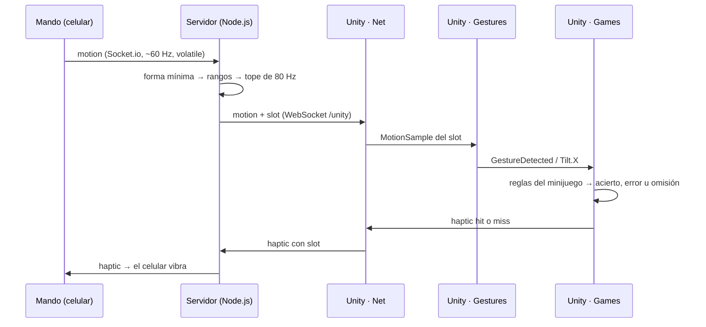
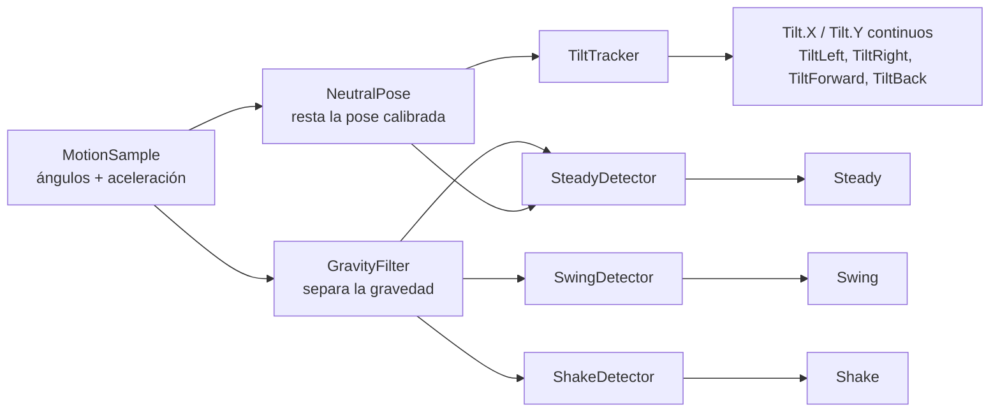
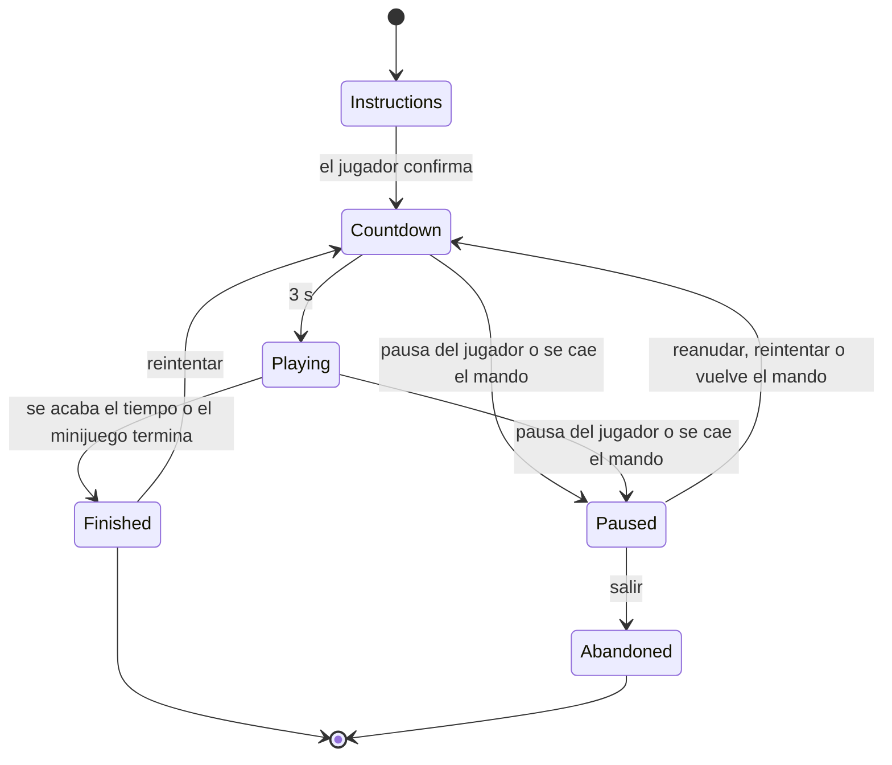

# Juego y servidor por dentro

Cómo funcionan los módulos de **Piero Mejía**: salas y retransmisión en el
servidor (`server/src/rooms/`, `server/src/relay/`) y red, gestos y minijuegos en
Unity (`unity/Assets/Scripts/`). Requisitos: RF-01, RF-04, RF-06, RF-07, RF-09,
RF-11, RF-19, RF-20; RNF-02, RNF-08.

Este documento explica el **porqué y el cómo por dentro**. Para usar cada módulo
desde código está [unity/README.md](../unity/README.md) y
[server/README.md](../server/README.md); el contrato de mensajes, en
[protocolo-ws.md](protocolo-ws.md); la postura y los gestos por minijuego, en
[gestos.md](gestos.md).

---

## 1. El viaje de un gesto

Del celular a la pantalla y de vuelta al celular, en una sola red Wi-Fi:

Cada capa hace una sola cosa. El servidor **no interpreta gestos** y un
minijuego **nunca lee sensores crudos**: consume gestos ya reconocidos (RNF-08).
Por eso agregar un minijuego no obliga a tocar `Net/` ni `Gestures/`.

---

## 2. Servidor: salas y retransmisión (RF-01, RF-04, RF-07, RF-20)

### Salas y mandos

- **Código de sala:** 4 caracteres de un alfabeto sin los que se confunden al
  leerlos en la TV (sin `I`, `L`, `O`, `0` ni `1`): 31 símbolos, casi un
  millón de códigos posibles.
- **El rol lo fija el primer mensaje:** `create_room` es el juego y `join` es
  un mando. Un mensaje de otro tipo antes de eso se descarta.
- **Hasta dos mandos por sala (RF-20):** el tercero recibe `room_full`.
- **Un slot desconectado queda reservado:** si el mando vuelve, recupera su
  slot y la partida sigue (RNF-07). Solo si no hay ninguno reservado se ocupa
  uno libre.
- **Si el juego se va, la sala se cierra** y los mandos reciben
  `room_not_found`.
- **QR:** `GET /qr/<código>` devuelve un PNG de 512 px con la URL del mando;
  Unity lo muestra en pantalla.

### Validación en capas

Todo mensaje de un mando pasa por tres filtros antes de llegar a Unity; si falla
uno, se descarta y queda registrado en la consola del servidor:

| Filtro | Dónde | Qué rechaza |
| --- | --- | --- |
| Formato | `relay/parse-message.js`, `relay.js` | JSON roto, sin campo `t`, tipo desconocido, sala que no coincide |
| Forma mínima | `relay/message-shape.js` | `seq` o `ts` no enteros, ángulos o aceleraciones no numéricos (`NaN` viaja como `null`) |
| Validación | `validation/` (Misael) | Valores fuera de rango y `motion` a más de 80 Hz por mando |

Rangos aceptados: `alpha` de 0 a 360, `beta` de −180 a 180, `gamma` de −90 a 90
y aceleración de −60 a 60 m/s² en cada eje. Al mando se le avisa con
`bad_message` como máximo una vez por segundo, para no inundar la red.

### Desconexión

Un vigilante (`relay/pad-watchdog.js`) anota cuándo llegó el último mensaje de
cada mando y revisa cada 250 ms. Tras **2 s en silencio**, Unity recibe
`pad_state: disconnected` aunque el socket siga abierto: así se detecta también
un celular que se bloqueó o salió de la página. Al volver a llegar datos, se
avisa `connected`.

### Dos canales, un solo relay

- **Mando:** Socket.io sobre HTTPS, porque el navegador solo entrega los
  sensores con conexión segura.
- **Unity:** WebSocket puro en `ws://127.0.0.1:3444/unity`, un puerto que solo
  escucha en la misma PC: no necesita certificado y no queda un puerto sin
  cifrar abierto a la red.
- Los dos canales usan el mismo JSON y el mismo relay. Si Unity se atrasa, los
  `motion` viejos se descartan en vez de acumularse: un dato perdido es mejor
  que un gesto que llega tarde (RNF-01).

---

## 3. Unity: red (`Scripts/Net`, RF-01, RF-07)

- **`ServerConnection`** abre el WebSocket, crea la sala en cuanto conecta y,
  si se corta, reintenta a los 0,5 / 1 / 2 / 4 / 5 s. Si se reconecta, la sala
  es nueva y los mandos tienen que volver a escanear.
- **`GameLink`** traduce cada mensaje del servidor a un evento de C# y arma los
  mensajes de salida con `JsonUtility`. No es un componente de escena, así que
  se prueba sin abrir escenas ni conectarse a un servidor.

| Mensaje del servidor | Evento de `GameLink` |
| --- | --- |
| `room_created` | `RoomCreated(código, url)` |
| `pad_state` | `PadConnectionChanged(slot, conectado)` |
| `motion` | `MotionReceived(slot, muestra)` |
| `button` | `ButtonPressed(slot, acción)` |
| `calibrate` | `CalibrateRequested(slot)` |
| `error` | `ErrorReceived(código)` |

- **`RoomQrLoader`** descarga el QR de la sala para mostrarlo en la TV.

---

## 4. Unity: reconocimiento de gestos (`Scripts/Gestures`, RF-05, RF-06)

Hay un `GestureRecognizer` por mando. Cada lectura del celular pasa por esta
cadena:

| Pieza | Qué hace | Valores por defecto |
| --- | --- | --- |
| `NeutralPose` | Promedia la pose al calibrar o recentrar; desde ahí, todo es relativo a ella | Ventana de 300 ms |
| `TiltTracker` | Inclinación continua de −1 a 1 y eventos al cruzar el umbral | Zona muerta 4°, entra a 20°, sale a 10°, tope 40° |
| `GravityFilter` | Filtro paso bajo: lo lento es gravedad, lo rápido es movimiento del brazo | Constante de 0,25 s |
| `SwingDetector` | Un golpe de aceleración lineal | Umbral 14 m/s², enfriamiento 350 ms |
| `ShakeDetector` | Varios picos seguidos | 3 picos de 8 m/s² en 800 ms, enfriamiento 600 ms |
| `SteadyDetector` | Celular quieto y sin girar | Menos de 1,2 m/s² y 5° durante 1,5 s |

Decisiones que conviene conocer:

- **Histéresis en la inclinación:** para entrar hace falta 20° y para salir basta
  bajar de 10°; así el foco de un menú no tiembla entre dos opciones.
- **Recarga de la página del mando:** el reloj del celular vuelve atrás; el
  reconocedor lo detecta y reinicia sus filtros en vez de calcular con datos
  mezclados.
- **Ejes invertidos:** si en un celular real un eje sale al revés, se corrige
  con `InvertX` / `InvertY` en `Settings/Gestures/GestureSettings.asset`, sin
  tocar código. Ese asset se puede editar en el Inspector durante el Play.

---

## 5. Unity: base de minijuegos (`Scripts/Games/Core`, RF-09, RF-19, RNF-08)

### El ciclo de vida de una partida

`GameSession` es igual para todos los minijuegos:

- **Toda reanudación pasa por la cuenta regresiva:** el jugador nunca vuelve a
  la partida de golpe.
- **Una pausa del jugador no se levanta sola** al volver el mando; una pausa por
  desconexión, sí.
- **Si falta un mando al reanudar**, la partida sigue en pausa esperándolo.
- **Solo una partida terminada guarda puntaje** (`ShouldSaveScore`); salir desde
  la pausa no guarda (RF-19).
- **El tiempo de juego no corre** en pausa ni en la cuenta regresiva.

### Qué implementa un minijuego

Un minijuego es una clase que hereda de `MinigameRules` y sobrescribe solo lo que
necesita:

| Método | Cuándo se llama |
| --- | --- |
| `OnStart()` | Al empezar la primera vez |
| `OnTick(segundos)` | Cada cuadro mientras se juega |
| `OnGesture(gesto)` | Con cada gesto, ya filtrado |

Lo único que ve de la partida es `IMinigameContext`: la dificultad, el tiempo
jugado y el restante, la inclinación de un mando (`GetTilt`), `Report` para
informar un acierto, un error o una omisión con su tiempo de reacción, y
`Finish` para los juegos por rondas que terminan antes del tope.

Antes de llegar a las reglas, la sesión **filtra los gestos**: solo pasan
mientras se juega, de los mandos de esa partida y del tipo que permite la
dificultad (`DifficultyProfile`).

### El catálogo cuida las reglas de diseño

`MinigameCatalog.Register` rechaza un minijuego que:

- dure menos de 3 o más de 5 minutos en alguna dificultad (RNF-05);
- use swing y sacudir a la vez, porque se confunden entre sí
  ([gestos.md](gestos.md)).

### La partida corriendo en Unity (`Scripts/Games/Unity`)

- **`CoreSystems`** es un prefab con la conexión, los gestos, el QR y el
  `GameRunner`. Sobrevive a los cambios de escena, para que la sala no se cierre
  al pasar del menú al minijuego. Cada escena lleva una copia para poder abrirse
  sola; si ya hay una viva, la copia se apaga.
- **`GameRunner`** crea la `GameSession`, la hace avanzar cada cuadro, le pasa
  los gestos y la desconexión de los mandos, y avisa al celular: `hit` o `miss`
  en cada acierto o error (la omisión no vibra) y `playing` o `paused` según el
  estado.
- **`SessionControls`**: el botón `confirm` en las instrucciones empieza la
  cuenta regresiva; `pause` pausa y, estando en pausa, reanuda.

---

## 6. Atrapa lo correcto (`Games/AtrapaLoCorrecto`, RF-11)

Atención selectiva: atrapar solo los objetos de la categoría pedida.

### Reglas

- **La canasta sigue al celular** por posición: inclinar del todo la lleva al
  borde. Se mueve con un suavizado muy corto (unos 40 ms), para que no tiemble
  sin sentirse lenta.
- **Caen objetos de 3 categorías.** Una es la pedida y se muestra en el panel
  de la izquierda desde las instrucciones.
- **Al llegar abajo, cada objeto se resuelve.** Cuenta como atrapado si está
  bajo la canasta, sumando el ancho de la canasta y el radio del objeto:

| El objeto… | Atrapado | No atrapado |
| --- | --- | --- |
| es de la categoría pedida | **acierto** | **omisión** |
| es otro (distractor) | **error** | no se informa |

- **Tiempo de reacción:** desde que aparece el objeto hasta la primera vez que
  la canasta queda debajo de él.

### Dificultad (`AtrapaTuning`)

| | Fácil | Medio | Difícil |
| --- | --- | --- | --- |
| Duración | 3 min | 4 min | 5 min |
| Aparece un objeto cada | 2,2 s | 1,6 s | 1,1 s |
| Tarda en caer | 4,0 s | 3,2 s | 2,4 s |
| Ancho de la canasta | 25 % del campo | 20 % | 16 % |
| Objetos de la categoría pedida | 60 % | 50 % | 40 % |
| Movimiento lateral | recto | recto | Wandering |

En difícil los objetos pasean de lado a lado mientras caen, con la técnica
Wandering de Reynolds. La caída sigue a velocidad fija, así que el tiempo para
reaccionar es el mismo y los tiempos de reacción se pueden comparar entre
partidas. Detalle en [tecnicas-de-movimiento.md](tecnicas-de-movimiento.md).

### La escena (`Game_AtrapaLoCorrecto`)

`AtrapaView` solo dibuja lo que exponen las reglas (`BasketX`, `Items`) y hace
un destello corto al atrapar. Usa los modelos 3D de
`unity/Assets/Art/AtrapaLoCorrecto/`; si falta alguno, dibuja la forma
primitiva de respaldo. La dificultad de la escena se elige en el Inspector de
`AtrapaView`.

---

## 7. Pruebas que cubren estos módulos

| Módulo | Archivo de pruebas | Pruebas |
| --- | --- | --- |
| Servidor: relay y validación en el relay | `server/src/relay/relay.test.js` | 15 |
| Servidor: salas y slots | `server/src/rooms/room-registry.test.js` | 6 |
| Servidor: canal de Unity | `server/src/relay/ws-transport.test.js` | 3 |
| Servidor: canal del mando | `server/src/relay/socketio-transport.test.js` | 1 |
| Unity: gestos | `GestureRecognizerTests` | 26 |
| Unity: ciclo de la partida | `GameSessionTests` | 16 |
| Unity: partida con el mando (vibración, estado, botones) | `SessionBridgeTests` | 14 |
| Unity: mensajes del servidor | `GameLinkTests` | 13 |
| Unity: reglas de Atrapa | `AtrapaLoCorrectoTests` | 10 |
| Unity: catálogo | `MinigameCatalogTests` | 6 |
| Unity: Wandering | `WanderingTests` | 6 |
| Unity: escena real de Atrapa (PlayMode) | `AtrapaSceneTests` | 1 |
| **Total** | | **117** |

Las pruebas del servidor corren con `cd server && npm test`; las de Unity, desde
el Test Runner (EditMode y PlayMode) o en modo batch.

---

## 8. Lo que falta de estos módulos

Según [trazabilidad.md](trazabilidad.md):

- Menú de Unity para elegir minijuego y dificultad (RF-09); el catálogo ya está.
- Los minijuegos Sigue la secuencia, Corta sin fallar y Equilibrio (RF-12 a
  RF-14).
- Dos mandos en Unity (RF-20); el servidor ya los soporta.
- Ajustar los umbrales de los gestos con celulares reales (RF-06).
- Medir 60 fps con el Profiler en la escena más pesada (RNF-02).
