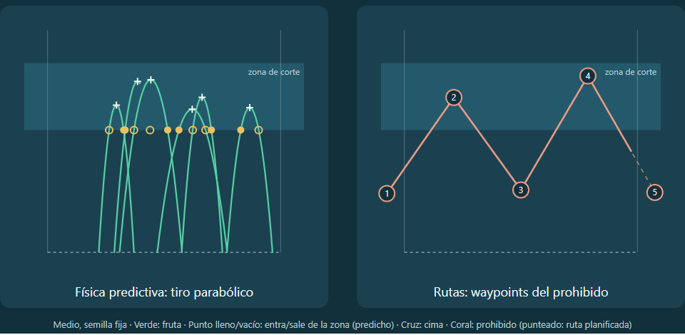
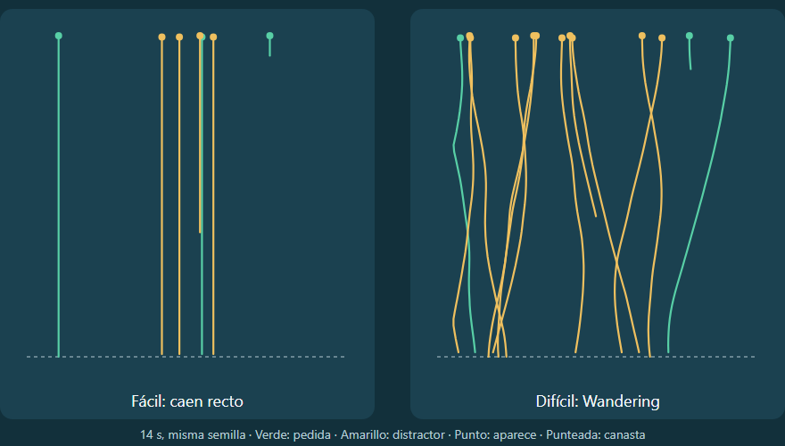

# Técnicas de movimiento

| Fase | Técnica | Nivel | Código |
| --- | --- | --- | --- |
| 2 | Física predictiva (lanzamiento de proyectil) | Corta sin fallar (RF-13) | [`Projectile.cs`](../unity/Assets/Scripts/Games/CortaSinFallar/Projectile.cs) |
| 2 | Rutas (waypoints) | Corta sin fallar (RF-13) | [`WaypointFollower.cs`](../unity/Assets/Scripts/Games/CortaSinFallar/WaypointFollower.cs) |
| 1 | Wandering | Atrapa lo correcto (RF-11), difícil | [`Wandering.cs`](../unity/Assets/Scripts/Games/AtrapaLoCorrecto/Wandering.cs) |

# Corta sin fallar: física predictiva y rutas

Nivel: **Corta sin fallar (RF-13)**, en las tres dificultades. Se juega con
*swing*: un golpe brusco del celular corta todo lo que esté dentro de la
**zona de corte**, una franja horizontal de todo el ancho de la pantalla. Hay
que cortar las frutas (acierto) y dejar pasar el objeto prohibido (cortarlo es
error): mide reacción e inhibición.

Pruebas: [`CortaSinFallar/Tests/`](../unity/Assets/Scripts/Games/CortaSinFallar/Tests/)
(`ProjectileTests`, `WaypointFollowerTests`, `CortaSinFallarTests`).



Cada línea es el recorrido real calculado por las reglas del juego (medio,
semilla fija, sin cortar nada).

## Física predictiva: lanzamiento de proyectil

Las frutas se lanzan desde abajo en **tiro parabólico** sin rozamiento:

```
x(t) = x0 + vx·t
y(t) = y0 + vy·t − ½·g·t²
```

Lo "predictivo" es que el problema se resuelve **al revés y antes de lanzar**.
El juego elige dónde quiere la cima (siempre dentro de la zona de corte) y
despeja las velocidades:

1. Altura de la cima: `h = vy² / (2·g)`  →  `vy = √(2·g·h)`.
2. Tiempo de subida: en la cima `vy(t) = vy − g·t = 0`  →  `tCima = vy / g`.
3. En ese tiempo tiene que recorrer el ancho: `vx = (xCima − x0) / tCima`.

Con la parábola ya conocida, el juego **predice cuándo se va a poder cortar**
la fruta: despeja `t` en `y(t) = borde inferior de la zona` (una ecuación de
segundo grado) y obtiene los dos instantes en que la cruza, subiendo y bajando.
Ese intervalo es la ventana de corte:

- un *swing* dentro de la ventana es **acierto**, y el tiempo de reacción se
  mide desde que la fruta entró a la zona;
- si la fruta vuelve a caer sin que la corten, es **omisión**.

La posición nunca se integra cuadro a cuadro: es una fórmula cerrada del
tiempo. Por eso lo que el juego predice y lo que se ve coinciden exactamente,
también después de una pausa.

| Dificultad | Gravedad `g` | Tiempo en la zona (cima a 0,7) | Fruta cada |
| --- | --- | --- | --- |
| Fácil | 0,9 | 1,15 s | 2,4 s |
| Medio | 1,3 | 0,96 s | 1,8 s |
| Difícil | 1,8 | 0,82 s | 1,3 s |

Más gravedad, con la cima a la misma altura, da un vuelo más corto y menos
tiempo para reaccionar.

## Rutas (waypoints)

El objeto prohibido cruza la pantalla siguiendo una **ruta**: una lista
ordenada de cinco puntos que entra por un costado, sube a la zona de corte,
baja, vuelve a subir y sale por el otro lado (zigzag).

En cada cuadro:

1. Va en línea recta hacia el waypoint actual, a velocidad constante.
2. Si en este cuadro le alcanza para llegar, se para en el waypoint y pasa al
   siguiente.
3. **Lo que le sobra del recorrido de ese cuadro lo sigue usando hacia el
   próximo**, así la velocidad no tiene saltos al doblar.
4. Al llegar al último waypoint, termina y sale de la pantalla.

Como la ruta cruza la zona de corte dos veces, el jugador tiene que **frenar el
impulso de cortar** justo cuando el prohibido pasa por ahí (inhibición). Cortarlo
es **error**; dejarlo pasar no se reporta, igual que el distractor de Atrapa lo
correcto.

| Dificultad | Velocidad del prohibido | Prohibido cada |
| --- | --- | --- |
| Fácil | 0,35 | 7 s |
| Medio | 0,45 | 5 s |
| Difícil | 0,6 | 3,5 s |

## Qué verifican las pruebas

- La fórmula inversa deja la cima exactamente donde se pidió, y el vuelo vuelve
  a la altura de salida en el doble del tiempo de subida.
- Los instantes predichos para una altura coinciden con la posición calculada.
- La ventana predicha coincide, cuadro a cuadro, con lo que se simula.
- *Swing* dentro de la ventana: acierto con el tiempo de reacción correcto;
  antes de que llegue: no corta; sin *swing*: omisión.
- El prohibido pasa por cada waypoint en orden, a velocidad constante, y usa el
  sobrante al doblar; su ruta cruza la zona de corte y sale del campo.
- Cortar al prohibido es error; dejarlo pasar no cuenta.
- Solo el *swing* corta; en pausa no se mueve ni se corta nada; la misma semilla
  da la misma partida.

# Atrapa lo correcto: wandering

Nivel: **Atrapa lo correcto (RF-11), dificultad difícil**.
Código: [`unity/Assets/Scripts/Games/AtrapaLoCorrecto/Wandering.cs`](../unity/Assets/Scripts/Games/AtrapaLoCorrecto/Wandering.cs).
Pruebas: [`Tests/WanderingTests.cs`](../unity/Assets/Scripts/Games/AtrapaLoCorrecto/Tests/WanderingTests.cs).

## Qué hace

En fácil y medio los objetos caen recto. En difícil cada objeto **pasea de lado
a lado mientras cae**: cambia de rumbo de forma suave e impredecible, y el
jugador tiene que seguirlo con la canasta en vez de solo esperarlo debajo.



Cada línea es el recorrido real de un objeto calculado por las reglas del juego
(misma semilla en los dos paneles).

## Cómo funciona (Wandering de Reynolds)

En cada cuadro, para cada objeto:

1. **Jitter:** el ángulo de un punto sobre un círculo se corre un poco al azar
   (hasta 40 rad/s).
2. **Círculo adelante:** el círculo se proyecta por delante del objeto, en la
   dirección en que ya se mueve (su velocidad lateral más la caída).
3. **Objetivo:** centro del círculo + el punto del borde. Eso da la velocidad
   lateral deseada, limitada a `WanderSpeed`.
4. **Steering:** la velocidad lateral se acerca a la deseada de a poco
   (`SteeringRate`), así el giro nunca es brusco.
5. **Borde:** si llega al borde del campo rebota, para que siempre se pueda
   atrapar.

Como el círculo va por delante, el objeto tiende a seguir el rumbo que traía, y
el punto que se mueve al azar hace que ese rumbo cambie poco a poco. Por eso el
recorrido es ondulado y sin zigzag.

## Decisiones de diseño

| Decisión | Motivo |
| --- | --- |
| Solo en difícil | En fácil y medio no se agrega movimiento que distraiga (RNF-05). |
| Solo movimiento lateral; la caída sigue a velocidad fija | El jugador tiene el mismo tiempo que sin wandering, y los tiempos de reacción se pueden comparar (RF-15). |
| Velocidad lateral máxima 0,25 (el campo mide 2) | Se nota el paseo, pero el objeto sigue siendo atrapable. |
| Azar con semilla (`System.Random`), no `Time.time` ni Perlin | La misma semilla da la misma partida: se puede probar sin Unity y repetir un caso. |
| Vive en las reglas, no en la escena | La escena solo dibuja `item.X`; el wandering funciona igual en las pruebas y en el juego. |

## Parámetros

| Dónde | Parámetro | Valor |
| --- | --- | --- |
| `AtrapaTuning` | `WanderSpeed` (fácil / medio / difícil) | 0 / 0 / 0,25 |
| `Wandering` | `CircleDistance` | 1 |
| `Wandering` | `CircleRadius` | 0,8 |
| `Wandering` | `JitterRadiansPerSecond` | 40 |
| `Wandering` | `SteeringRate` | 3 |

## Qué verifican las pruebas

- Fácil y medio: los objetos no se mueven de lado.
- Difícil: la mayoría se aleja más de 0,1 de donde apareció, nunca sale del
  campo y nunca salta de lado más de lo que permite `WanderSpeed` en un cuadro.
- Difícil: la caída mantiene su velocidad.
- La misma semilla da exactamente el mismo recorrido.
- Siguiendo al objeto con la canasta, se lo atrapa (acierto).

## Cómo verlo en Unity

Escena `Scenes/Game_AtrapaLoCorrecto` → objeto **Atrapa** → componente
`AtrapaView` → **Difficulty = Hard** → Play.
